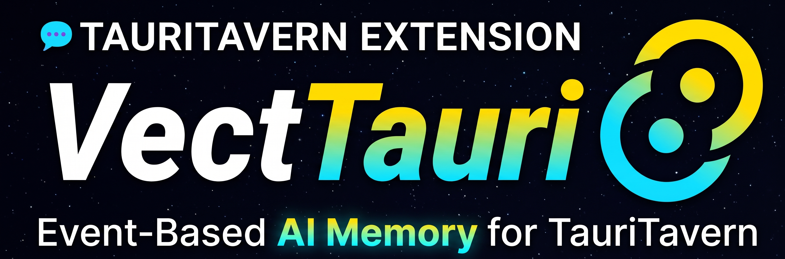

<p align="center">
  
</p>

# VectTauri — Advanced RAG for TauriTavern

> **Fork of [VectFox](https://github.com/KritBlade/VectFox)** by Kritblade — all VectFox credits belong to the original author. VectTauri adapts it for **TauriTavern** (Android).

VectTauri brings full RAG (Retrieval-Augmented Generation) memory to TauriTavern. Unlike the original VectFox, which needs the Similharity plugin inside SillyTavern's Node.js backend, VectTauri ships with a **built-in Similharity layer** that runs entirely on-device — no server, no Termux, no network setup required.

## ✨ Highlights

- **Zero setup** — install the extension and it works. Vectors are stored on-device through TauriTavern's native vector engine (Rust + redb + on-device embeddings)
- **Rich RAG metadata** — importance weighting, keywords, conditional activation, chunk groups, temporal data: everything the VectFox engine expects, preserved intact
- **Event-Based memory** — LLM-driven event extraction keeps meaningful story moments, not just recent messages
- **Memory that actually reaches the prompt** — retrieved events, pinned **Core Facts** and an always-on **Story State** note are injected straight into the prompt, not through lorebook triggers (see [Memory layers](#-memory-layers))
- **Its own LLM key** — summarization / EventBase use a key that is separate from TauriTavern's main chat, so switching the main provider no longer changes it

---

## 📋 Requirements

- **TauriTavern** (Android/desktop) — [Download](https://github.com/Darkatse/TauriTavern)
- **An Embedding Model** — powers vectorization and retrieval. Default: **Transformers (Local)**, running fully on-device with no setup. Optional API providers (Ollama, OpenRouter, vLLM, Electron Hub, or any Custom OpenAI-compatible `/embeddings` endpoint) can be selected in **VectTauri Settings → Embedding Provider**. Important: all vectors in a collection must come from the same model — switching models requires re-vectorizing.
- **An LLM for Summarization / EventBase** — EventBase event extraction and summaries need a chat model. Choose between **OpenRouter**, **vLLM**, or **any Custom OpenAI-compatible endpoint** (OpenAI, LiteLLM, siliconflow, proxies) in **VectTauri Settings → LLM Summarization & EventBase Extraction** — with Base URL, API key, and a model picker that fetches the model list from your endpoint. An optional **backup model** is used once when the main model times out or returns 429/5xx.
  The API key you enter in the Summarization / AgentMode key boxes is **VectTauri's own** and is not shared with TauriTavern's main chat. (The Embedding key boxes still use the shared slots.) If you never enter one, VectTauri keeps using the shared key, as before.

Everything else runs on-device.

### Recommended embedding models (multilingual)

Ollama models that handle non-English roleplay well. Pick one, then keep it — changing the model means re-vectorizing every collection (different vector space).

| Model | Params | Dims | Notes |
|---|---|---|---|
| `embeddinggemma:300m` | 300M | 768 | 100+ languages, built for on-device/low-end CPUs. Best size/quality balance |
| `snowflake-arctic-embed2` | 568M | 1024 | Multilingual. Heavier, noticeably slower on 2-core laptops |
| `bge-m3` | 568M | 1024 | Strong multilingual retrieval |
| `qwen3-embedding:0.6b` | 0.6B | 1024 | Multilingual, solid quality |

Do **not** use `snowflake-arctic-embed` (v1.x, the one without the `2`) for non-English chats — it is English-only.

```bash
ollama pull embeddinggemma:300m
# then set it in VectTauri Settings → Embedding Provider (source: Ollama)
```

---

## 🚀 Installation

1. Open **TauriTavern**
2. Go to **Extensions** panel (puzzle piece icon)
3. Click **"Install Extension"**
4. Paste this URL:
   ```
   https://github.com/lunarcadedigital/VectTauri
   ```
5. Click **Install** and open **VectTauri Settings**

The extension needs no transport configuration: the Similharity layer runs entirely in-app through the built-in engine. Set up the **Embedding Provider** and **LLM for Summarization** (see Requirements above), then:

### Getting started

1. Open a chat and open **VectTauri → Vectorization**
2. Click **"Vectorize Content"** to index the conversation
3. Retrieval starts injecting relevant memories into your prompts automatically
4. Use the **Database Browser** and **Chunk Visualizer** tabs to inspect what's stored

---

## 🧠 Memory layers

Long chats are forgotten for two different reasons: an important fact is never found again, or the *current situation* is not in the prompt. VectTauri covers both with layers that complement each other — none replaces another.

| Layer | What it is | Reaches the prompt | Where |
|---|---|---|---|
| **Events** | Structured events extracted by the LLM per window of messages (type, importance, summary, cause/result, characters, locations, date, keywords, open threads), stored in the vector DB | Only the ones similar to the current scene (Top-K, default 15) | EventBase tab |
| **Core Facts** | Events you **pin** (thumbtack in the chunk viewer). Optionally auto-pinned (importance ≥ 8 and persistent) | **Always**, in a labelled "Core facts" block, before the retrieved events | Chunk viewer, EventBase tab (cap: default 8) |
| **Story State** | One short note per chat: where/when now, who is present, the player character's premise, relationships, items, open threads. Updated incrementally by the LLM | **Always** | EventBase tab → Story State |

**Story State details**

- Updated every *N* extraction windows (default 3) with the same LLM as EventBase — one extra call per update. On by default; untick it in the EventBase tab to turn it off.
- You can edit the note, **Lock** it so it is never overwritten, **Undo** the last auto-update, or **Clear** it.
- A full **Vectorize Content** run builds the note automatically when the chat has none yet. For a chat you already vectorized, or to start over, press **Rebuild from whole chat** (about one LLM call per 30 messages; nothing changes unless every step succeeds).
- A reply that is empty, garbled, or far shorter than the previous note is rejected and the old note is kept.

**Other helpers**

- **Relative time hints** — injected events carry labels like "(3 days earlier)", measured against the newest dated event in the same block. Nothing is added when a date is missing or unclear.
- **Last retrieval** (EventBase tab) — shows, for the latest generation, which events were retrieved, their scores, and why near-misses were dropped. Use it to tell "never stored" from "retrieved but ranked low" from "injected but ignored by the model".

---

## ⚠️ Known limitations

- **Qdrant** needs routes the built-in Similharity layer does not provide. Use the default **Standard (Vectra)** backend.
- **Query scores:** TauriTavern's vector API returns result *order* and applies the threshold, but not the similarity score itself. VectTauri ranks correctly, but the score values it shows are rank-derived, not true cosine similarity. (It will use real scores automatically if TauriTavern starts returning them.)
- **Re-embedding a chunk's text** is not supported for Custom / Electron Hub embedding sources in the built-in layer; delete and re-insert the chunk instead.
- Pins and Story State notes are stored in the extension settings, so they do not travel with an exported collection or chat.

---

## 🔁 Resuming Vectorization

If a vectorization run stops partway — app closed, **Stop** pressed, or the LLM provider failed (quota exhausted, HTTP 502, etc.) — you don't need to re-index the whole chat:

1. Fix the cause first (e.g. switch to a working LLM model, or top up the provider)
2. Open **VectTauri → Vectorization → Chat History**
3. Leave **Start From Message** at **`1`**
4. Click **Resume**

Resume rebuilds its extraction fingerprints from the chunks already stored in the database, so it **skips windows that are already vectorized and only extracts the gaps** (for example messages 110–195). It is safe to run repeatedly.

**Important**

- **Start From Message must stay `1`.** That field means "discard every message before N" — it is *not* a "continue from here" point. Typing the last vectorized message number shifts window boundaries, invalidates the stored fingerprints, and re-extracts everything (with overlapping events).
- **Keep the same Window Size** used for the original run. Dedup fingerprints are window-size dependent; changing it makes every window look new and forces a full re-extraction.
- If the previous run failed because of the LLM provider, Resume will fail the same way until the provider/model is fixed.

---

## 🔄 Updating

Update the extension from **Extensions panel → Check for Updates**, or reinstall from the URL above.

---

## 📝 Changelog

### Unreleased (experimental branch)

**Added**
- **Story State** — an always-injected, auto-updating "current situation" note per chat, with Lock / Undo / Clear / Rebuild from whole chat. Built automatically after a full Vectorize Content run when the chat has no note yet.
- **Core Facts** — pin events so they are always injected; optional auto-pin; per-collection cache so it costs nothing per generation after the first load.
- **Last retrieval inspector** — per-generation view of retrieved events, score components and dropped candidates.
- **Relative time hints** — "(3 days earlier)" labels on injected events.

**Changed**
- Default vector backend is now **Standard (Vectra)**.
- Built-in Similharity layer is closer to the real plugin: chunk text/metadata editing from the chunk viewer now works, `list` supports full paging info, `stats` returns the plugin's fields, and queries report when scores are rank-derived.

### Main

**Added**
- Summarization / EventBase / AgentMode / Auto-Reformat use their **own API key**, independent of TauriTavern's main chat.
- **Electron Hub** and **Custom (OpenAI-compatible)** embedding providers.
- Optional **backup model** for EventBase extraction (sticky for the rest of a run) with a **Test Backup** button.
- Indonesian story-language mode for EventBase extraction and BM25 stopwords.
- EventBase injections recorded in the Search Debug modal.

**Changed**
- EventBase defaults raised for recall: **Retrieve Top-K 10 → 15**, **Max Events per Window 3 → 5**. (Saved settings are not changed; re-vectorize to apply the new extraction cap to old chats.)
- UI palette switched to Tauri cyan/yellow.

**Fixed**
- Query embeddings for Electron Hub / Custom sources were always empty.
- Stale "shared with Summarize + AgentMode" key texts.
- Chunk message ranges now display 1-based, matching chat numbering.
- Database Browser loads all chunks instead of a truncated subset.

---

## 📄 License

MIT License

---

## Credits

- **[KritBlade](https://github.com/KritBlade)** — Original VectFox & Similharity plugin
- **[Darkatse](https://github.com/Darkatse)** — TauriTavern

---

## Contributors

| Name | Division | Role |
|---|---|---|
| Gilang Permadi | Web | Web Developer |
| Ika | Web | Web Integration Engineer |
| Fajar Nugroho | QA | QA Automation Engineer |
| Nina Salsabila | Research | Research Analyst |
| Agus Pratama | Asset | 2D Asset Composer |
| Sari Dewi | Archive | Archive Engineer |
| Ahmad Fauzi | Release | Release Engineer |
| Dimas Pratama | Fixing | Maintenance Engineer |
| Raka Wiraguna | Design | UX Designer |
| Dewi Lestari | Architect | Database Architect |
